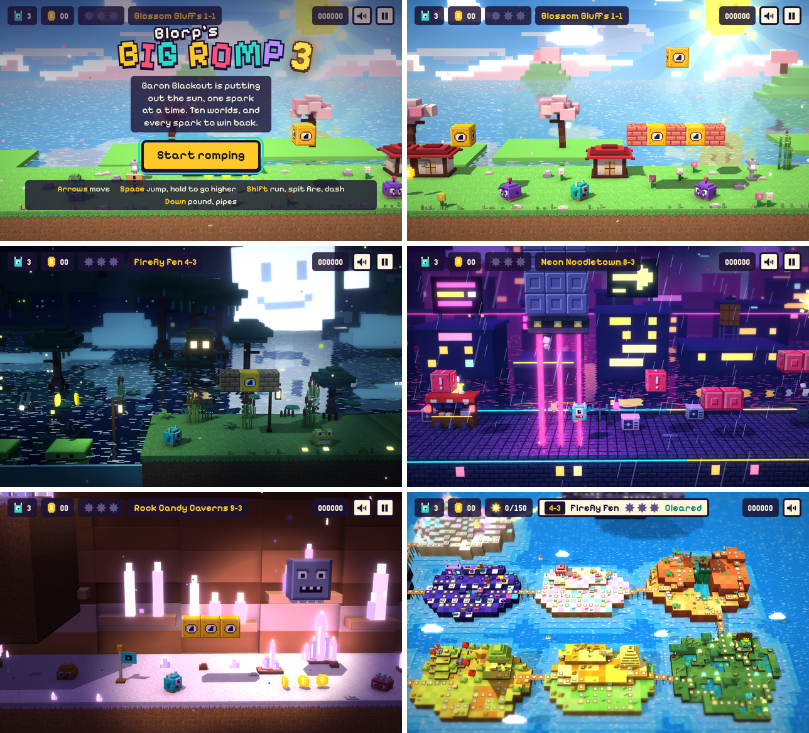

# Blorp's Big Romp 3

A voxel platformer with a 2.5D side-scrolling view, built with [three.js](https://threejs.org/), and the third of Blorp's romps, after [Blorp's Big Romp](https://github.com/glennbacon/blorps-big-romp) and [Blorp's Big Romp 2](https://github.com/glennbacon/blorps-big-romp2). Baron Blackout is putting out the sun, one spark at a time. Blorp, a one-eyed teal monster, crosses ten worlds and fifty levels to win them back: three sun sparks are hidden in every level, 150 in all.

**[Play it in your browser](https://glennbacon.github.io/arcade/blorps-big-romp-3/)**



It is one of the games in [Glenn Bacon's arcade](https://glennbacon.github.io/arcade/), next to the first two.

The whole game is one HTML file. There are no image or sound files: every model is built in code from boxes, every texture is drawn on a 16×16 canvas, and all music and sound effects are synthesized with the Web Audio API.

## Play

Play online at <https://glennbacon.github.io/arcade/blorps-big-romp-3/>.

To run it from a copy of this repository, open `index.html` in a current version of Chrome, Safari, Firefox or Edge. Nothing needs installing. An internet connection is needed either way because three.js and the fonts load from CDNs.

## Controls

In a level:

| Action | Keyboard | Touch |
| --- | --- | --- |
| Move | Arrow keys or A / D | Arrow pads |
| Jump (hold to go higher), swim, kick off a wall | Space, Up, W or Z | A |
| Run; spit fire in fire form; dash in sun form | Shift or X | B |
| Ground pound (in the air), go down a pipe, sink faster | Down or S | ▼ |
| Pause | P or Esc | Pause button |
| Sound on/off | M | Sound button |

On the map:

| Action | Keyboard | Touch |
| --- | --- | --- |
| Walk along the path | Arrow keys or W A S D | Four-way pad |
| Walk faster | Shift or X | B |
| Play the level Blorp stands on | Space, Enter, Z or K | A |
| Sound on/off | M | Sound button |

On a phone held upright the game sits above a handheld-style control deck. In landscape the controls float over the bottom corners, and in a level the view rides up so the ground Blorp walks on stays above them.

## What is new since the second game

**The picture**

The renderer has been rebuilt around knowing how far away every pixel is.

- **Mirrors in the water.** Still water shows the world upside down: hills, clouds, lanterns, the sun, Blorp himself.
- **Depth.** What is far behind the lane Blorp walks in, or close in front of the camera, goes softly out of focus, like a model seen close up.
- **Shade and light.** Corners where surfaces meet are shaded; shafts of sunlight fan out round whatever stands in front of the sun; every voxel has a bevel that catches the light along its top edges; turf overhangs the earth it grows on.
- **Dark levels.** In a cave or at night the picture is dimmed to what Blorp, the lamps and anything glowing can light.
- **Sky.** Decks of drifting cloud, shooting stars, northern lights, coloured dust, and for the last world an eclipse. It is still drawn in the game's chunky pixels.
- **Weather.** Petals, leaves, snow, rain, embers, fireflies, bubbles, spores and confetti, near the camera and far from it.
- **Effects.** A ground pound or a blast bends the picture in a ring. Plants part as Blorp walks through them. Water, heat and the dark each do something to the whole screen.

The pause screen has a graphics setting; on *Auto* the game steps down by itself if a device cannot keep up.

**Moves and power-ups**

- Wall kick, ground pound, swimming and pipes are as before, and so are the muffin (big), chili (fire spit), candyfloss (fluff: a second jump and a glide), star jelly and the heart.
- **Sunbloom** gives the sun form. Blorp shines, which matters in the dark, and the run button becomes a **dash**: a burst straight ahead that gravity cannot touch. It bowls monsters over, breaks bricks side on, sets off any block it meets, and can be done once more in mid-air.

**Sun sparks**

Every level hides three. One is usually in plain sight, one takes a trick, and one is tucked away. A spark is kept the moment it is touched, even if Blorp then loses a life. The map shows how many each level has given up.

**Things in the levels**

New: bouncy blocks (drums, hay bales, trampolines: hold jump as you land to go high, pound one to go higher still), sticky blocks (slow to walk on, but a sticky wall holds whoever slides down it), geysers that carry Blorp up, lasers on a timer or a switch, chutes that let rollers out, ledges that swing on ropes, red and blue blocks that change over on a beat, a tide that rises, and levels in the dark. Back from before: crumbling blocks, conveyor belts, the red and blue switch, launch pods, falling and circling ledges, updrafts, flame jets, cannons, hint signs and secret rooms.

**Monsters**

New: Petalpuff, a dandelion that drifts after Blorp; Buzzby the bee, who dives; Gloop, who splits in two when stomped; Ribbit, whose tongue has to be jumped; Wisps that circle in the dark; Swoops that dive across their beat; Rattles the skeleton, who gets up again; rollers; Mimics that look like blocks; Zapbots that shoot straight; Totters, three to a stack; saws on tracks; balloons to bounce on; and Smudge, Blorp's own shadow, who does whatever he did a moment ago. Most of the first two games' monsters are back as well, many in a new body for the world they turn up in.

Some worlds have creatures nobody else has: hay carts to ride in the orchard, grubs that let go of the hive's ceiling, a Dozy asleep in the fen and a Gulper under it, the wind-up Tick-Tock at the fair, notes that hop on the beat, pigeons over the rooftops, Glimmers that carry a lamp through the caverns, and the Baron's Snuffers.

**Bosses**

Granny Smash in the orchard, King Croak in the fen, Ringmaster Razzle at the fair, Wokbot 3000 on the rooftops, and Baron Blackout in his bastion. Each takes stomps: three, three, four, four and six.

**Worlds**

1. **Blossom Bluffs**: a garden in spring, and the place to learn the moves.
2. **Caramel Orchard**: autumn, hay bales and things that roll downhill.
3. **Honeycomb Heights**: a hive, and honey that sticks.
4. **Firefly Fen**: a swamp at dusk, getting darker.
5. **Fossil Falls**: a canyon of bones, geysers and waterfalls.
6. **Popcorn Park**: a funfair at night, on a pier.
7. **Boombox Boulevard**: everything moves to the beat.
8. **Neon Noodletown**: rooftops in the rain, lasers and Zapbots.
9. **Rock Candy Caverns**: crystal caves, in the dark.
10. **Blackout Bastion**: the Baron's fortress, under the eclipse.

**Sound**

Every tune is new: a four- to six-track sequencer with chords, a filter on each instrument that can pluck or swell, a room to play in, and instruments placed from left to right. Effects come from the side of the screen they happen on, and every world has small sounds of its own under the music: birds, crickets, drips, rain.

## Saved progress

The game remembers, in the browser's local storage, how far the path is open, which marker Blorp stands on, his score, coins, lives and power-up, every sun spark found, and the graphics setting if one was chosen by hand. The title screen then offers **Continue**. Game over resets the score, coins, lives and power-up but not the map or the sparks. If the browser blocks storage, the game still plays but forgets where you were.

## Physics

Walking, running, skidding and jumping use the NES Super Mario Bros. speeds and gravities, converted from pixels per frame to tiles per second, with the first game's slightly stronger jump (about 4.2 tiles standing, 5 running) and its jump buffering and ledge forgiveness. The simulation runs at a fixed 120 steps per second, independent of frame rate.

## Project layout

| Path | What it holds |
| --- | --- |
| `index.html` | The built, playable game |
| `src/head.html` | Page markup, styles, HUD, screens and touch deck |
| `src/a_art.js` | Voxel geometry builder, materials, pixel textures and every shared model |
| `src/b_levels.js` | Tile types, the level builder, and the list of worlds |
| `src/c_audio.js` | Sound effects, the sequencer, and the tunes every world shares |
| `src/d_render.js` | Renderer, lights, shadows, the sky, quality settings and post-processing |
| `src/e_world.js` | Terrain mesher, water and its mirror, the scenery framework and the level camera |
| `src/e2_fx.js` | Flying bits, weather, rings and pop-ups |
| `src/f_play.js` | Player physics, blocks, power-ups, pipes, ledges and everything else that moves by rule |
| `src/g_enemies.js` | Every shared monster, and the bosses |
| `src/worlds/` | One file per world: its tune, its looks, its scenery, its five levels and its island on the map |
| `src/m_map.js` | The world map's islands, its route, and the rules of what is open and of walking |
| `src/n_mapview.js` | Drawing the world map |
| `src/z_flow.js` | Level loading, animation, screens, saving, input and the main loop |
| `src/tail.html` | Closing markup |
| `build.sh` | Joins the pieces in `src/` into `index.html` |
| `screenshot.png` | The picture at the top of this page |
| `tools/` | Checks that run in Node, and a camera (see below) |

## Build

```bash
./build.sh
```

This needs only bash. If Node.js is installed, the script also checks the game script for syntax errors and for two things in different files that have been given the same name.

## Checks

```bash
node tools/check-levels.js              # every level and every spark; add --jobs 4 to use four processes
node tools/check-levels.js 4-2          # one level
node tools/check-levels.js --quick 4-2  # the way to the flag only, not the sparks
node tools/check-levels.js --map 4-2    # print a level as text
node tools/check-map.js                 # the world map: its route, walking, opening levels, controls
node tools/check-map.js --map           # print the islands as text
node tools/check-save.js                # saved progress, sun sparks and Continue
node tools/check-audio.js               # every sound effect and every tune
```

These need Node.js and nothing else. The level check loads the game code from `src/` with the 3D and page layers stubbed out, then has a search bot play each level with the real rules until it reaches the flag or beats the boss. Each level is played as small Blorp and as big Blorp, who must not get hurt, and the bot jumps 5% lower than a player can. The bot then goes after each of the three sparks. It also reports common slips, such as a monster placed in mid-air, a pipe that leads nowhere, a roof low enough to hit when jumping for the flag, or a tree standing in front of the checkpoint flag. Run it after editing a level.

The map check proves there is one marker per level, that the path moves one cell at a time, never climbs more than one step, never crosses or runs alongside itself and is never hidden by the ground, and then drives the real walking rules, the flow between map and levels, and the map's keys and touch pad. The save check starts the game the way a page load does, with a stand-in for the browser's storage, and checks what is saved at each point and what the title screen offers afterwards. The audio check calls every effect and plays every tune twice through against a strict stand-in for Web Audio.

To look at a level without playing to it, there is a camera. It needs [Playwright](https://playwright.dev/) (`npm i playwright`), which nothing else here does:

```bash
node tools/shot.js out.png 3-2                # the start of level 3-2
node tools/shot.js out.png 3-2 120 2          # Blorp put at x 120, y 2
node tools/shot.js out- 3-2 20,2 80,2 140,6   # several places: out-0.png, out-1.png, out-2.png
node tools/shot.js out.png map 12 --zoom 2    # the map, Blorp on marker 12, from further off
node tools/shot.js out.png 3-2 60 2 --form 4  # as sun Blorp (0 small, 1 big, 2 fire, 3 fluff, 4 sun)
```

Where the network cannot reach the CDN that three.js loads from, set `THREE_JS` to a local copy of `three.min.js` (r128).

## Making levels

A level is a function that builds itself with a small builder and returns `B.L`. Coordinates are in tiles; the walking surface is at `y = 2` (ground fills rows 0 and 1), and a level is 16 tiles tall unless it asks for more.

```js
function w1l9(){
  const B=LevelBuilder(204,'bluffs');   // width in tiles, theme, and optionally height (default 16)
  B.ground(0,44).ground(48,203)         // ground from column 0 to 44, a gap, and on to the end
   .row(21,5,'B?BMB')                   // a row of blocks starting at column 21, height 5
   .pipe(31,2,true)                     // a pipe two tiles tall; true adds a Chomper
   .enemy('blob',27)                    // a monster standing on the ground at column 27
   .enemy('puff',40,6,{rx:3})           // one in the air at height 6, with options
   .plat(60,4,3,'x',5,1.3)              // a ledge 3 wide that slides 5 tiles along x
   .water(70,2,90,5)                    // a pool: both corners, in tiles
   .spark(80,3).spark(120,9).spark(150,4,'sun')
   .checkpoint(100)
   .goal(190);                          // the flag; a boss level ends with .boss(...) instead
  return B.L;
}
```

Characters for `row`:

| Char | Tile | Char | Tile |
| --- | --- | --- | --- |
| `B` | Brick | `m` | Brick holding many coins |
| `?` | Coin block | `s` | Brick holding a star |
| `M` | Power-up block (muffin, then chili) | `I` | Hidden block with a life |
| `F` | Power-up block (muffin, then candyfloss) | `i` | Hidden block with a coin |
| `O` | Power-up block (muffin, then sunbloom) | `H` | Hard block |
| `S` | Star block | `=` | One-way ledge |
| `L` | Life block | `^` | Spikes |
| `C` | Coin | `K` | Crumbling block |
| `#` | Ice | `<` `>` | Conveyor belt, left and right |
| `X` | Toggle switch | `J` | Bouncy block |
| `R` | Red block (solid until the switch is hit) | `Y` | Sticky block |
| `U` | Blue block (solid after) | | |

Everything the builder can do:

| Call | What it makes |
| --- | --- |
| `fill(x0,y0,x1,y1,TILE)` / `clear(x0,y0,x1,y1)` | A box of one tile (`GROUND`, `HARD`, `BRICK`, `ICE`, `BOUNCE`, `STICKY`, ...) or of nothing |
| `ground(x0,x1,h)` | Ground from row 0 up, `h` rows tall (default 2) |
| `ice(x0,x1,y)` | A strip of ice; with no `y`, the top row of ordinary ground |
| `row(x,y,'...')` | A row of tiles from the table above |
| `coins(x,y,n)` `coinCol(x,y,n)` `coinBox(x0,y0,x1,y1)` `arc(x,y,n)` | Coins in a row, a column, a block, and an arch for a jump |
| `stairs(x,n,dir,base)` | `n` steps of hard block, rising to the right (`dir` 1) or the left (-1) |
| `pipe(x,h,chomper,base)` | A pipe two tiles wide |
| `warp(x,h,tag,oneWay,base)` | A pipe Blorp can go down. Two warps with the same tag are the two ends; `oneWay` makes this end an exit only |
| `room(x0,x1,y0,y1,bonus)` | A part of the level the camera stays inside. The first room is where the level starts. Put a secret room beyond the hut, walled in, and reach it by a warp |
| `enemy(type,x,y,opts)` | A monster. `y` defaults to the ground |
| `plat(x,y,w,axis,range,speed,phase)` | A moving ledge: axis `'x'` or `'y'` slides, `'c'` circles at radius `range`, `'s'` swings on a rope `range` tiles long hung straight above where it is put (it swings about 0.8 of that to either side) |
| `fall(x,y,w)` | A ledge that drops away a moment after Blorp lands on it |
| `spring(x,y)` | A springshroom |
| `bounce(x0,x1,y)` | A run of bouncy blocks (the same as `J` in a row). A landing bounces about 4 tiles; with jump held, about 9; from a ground pound, about 13 |
| `sticky(x0,y0,x1,y1)` | A box of sticky blocks (the same as `Y`). Walking on them is slow and jumps from them are low (about 2 tiles). Sliding down a sticky wall, Blorp all but stops, so kicking up between two of them, or up one and a plain wall, is easy |
| `pod(x,y,angle,power)` | A launch pod, aimed `angle` degrees from straight up, firing at `power` tiles a second (24 goes about ten tiles up) |
| `wind(x0,y0,x1,y1,ax,ay)` | Moving air, as a push in tiles per second squared. About 110 upward lifts anyone; 60 lifts only a glider |
| `geyser(x,y,h,period,phase)` | A spout on the floor at row `y` that throws up a column `h` tiles high for about half of every `period` seconds (default 4.5). It hurts nobody: it carries Blorp to its top and holds him there, and he can jump from it |
| `jet(x,y,len,period,phase)` | A flame jet standing on the floor at row `y` |
| `laser(x,y,dir,len,period,phase,opts)` | A block at (x,y) whose beam runs `dir` (`'l'`, `'r'`, `'u'`, `'d'`) for up to `len` tiles or until something solid. It is on for half of every `period` seconds, after a flicker of warning; a period of 0 never goes off. `opts`: `duty` (the share of the time it is on), `sw:'red'` or `'blue'` (on by turns with the blocks of that colour instead), `col` |
| `cannon(x,y,period,phase)` | A block that fires rockets toward Blorp |
| `chute(x,y,period,dir,phase)` | A hatch at (x,y) that lets a roller out every `period` seconds, rolling `dir` (-1 left, 1 right). Rollers roll off ledges, bounce down steps, and break on the first wall. A roller's top is safe to bounce on |
| `firebar(x,y,n,speed,phase)` | A spinning chain of embers around a hard block |
| `spikes(x0,x1,y)` | Spikes |
| `water(x0,y0,x1,y1)` | A box of water to swim in |
| `liquid(y)` | Where the stuff in the pits stands (default 1.3) |
| `rise(speed,to,delay)` | The stuff in the pits rises: `speed` tiles a second, up to row `to`, starting `delay` seconds in. For climbs; make the level tall |
| `beat(period)` | The red and blue blocks change over by themselves every `period` seconds, with three ticks of warning |
| `conveyor(x0,x1,y,dir)` | A belt |
| `sign(x,text,y)` | A hint sign. `{jump}`, `{run}` and `{down}` become the right key or button names |
| `spark(x,y,needs)` | One of the three sun sparks. `needs` is `'fluff'`, `'fire'` or `'sun'` if it cannot be reached without |
| `checkpoint(x,y)` `start(x,y)` `goal(x,y)` | The halfway flag, where Blorp begins, and the flagpole (on the ground unless `y` says higher; it needs 18 tiles of floor after it) |
| `boss(x,x0,x1,hp,kind)` | A boss and the stretch it may move in (see below). A stomp takes 3 hit points |
| `look(i)` | Use another of the theme's looks than the one that goes with the level's number |
| `set(key,value)` | Leave a note on the level. `set('dark',0.7)` makes it a dark level (0 to about 0.85), `set('lightR',5)` is how far Blorp's own light reaches in it; anything else is for the theme's scenery, read there as `S.L[key]` |

Monster types and their options:

| Type | Options | Notes |
| --- | --- | --- |
| `blob` `spikit` `shellby` `boing` `prickle` `fizzle` `rammy` `snippy` | | Walkers from the first two games; stand them on something. A Spikit cannot be stomped; a Shellby leaves a shell to kick; a Boing hops at Blorp; a Prickle lobs seeds; a Fizzle is a bomb once stomped; a Rammy charges |
| `gloop` | | A slow walker that turns back at ledges. Stomped, it becomes two small quick ones |
| `bones` | | Walks its beat, turning at ledges. A stomp only knocks it down for a few seconds |
| `stack` | | Three high. Each stomp takes the top one off |
| `mimic` | | Sits like a block until Blorp is near, then hops after him |
| `ribbit` | | Sits. When Blorp is within about 5 tiles on its level it croaks, and half a second later its tongue goes out 3.6 tiles and back, low enough to jump |
| `batty` | `rx` `ry` `sp` | Flies a figure of eight that wide and tall |
| `puff` | `rx` | Floats at its height and drifts after Blorp up to `rx` tiles either way. Good to bounce off |
| `buzz` | | Hovers. When Blorp is below and within 6 tiles it shivers, dives straight at where he was, and flies home |
| `swoop` | `span` `dir` | Perches in the air. When Blorp is under its beat it swoops down to his height across `span` tiles (default 10, to the left unless `dir` is 1), and perches at the far end to come back |
| `drone` | `ry` | Hovers, keeps level with Blorp within `ry` tiles of its height, bleeps three times and shoots straight across |
| `wisp` | `rx` `ry` `sp` `phase` | Circles its spot for ever, and lights the dark. Only a star or a dash puts it out |
| `saw` | `rx` `ry` `sp` `phase` | Slides to and fro along a line from where it is put to `rx`, `ry` away. Not to be touched |
| `balloon` | `col` | Harmless. Good for one bounce, pops, and comes back three seconds later |
| `shade` | `until` | Blorp's shadow: it appears where he was 1.6 seconds ago and follows his every step until he is past x `until` |
| `chomper` | | Use `pipe(x,h,true)` |
| `icicle` | | Needs a solid tile directly above |
| `jelly` | `ry` `rx` `sp` | Must be in water. Bobs `ry` up and down from where it is put |
| `puffer` | `rx` `sp` | Must be in water. Swims `rx` either way |
| `snapper` `ember` | `rise` `gap` `phase` | Leaps `rise` tiles above where it is put, every `gap` seconds. Put it over a pit, at `y` 2 |
| `ghost` | | Floats through walls, and only moves while Blorp's back is turned |
| `clonk` | | Put it in the air; it drops to the floor when Blorp walks under, and climbs back. Its top is safe |
| `zappy` | `rx` | Hovers at its height, follows Blorp up to `rx` tiles either way, and drops bolts |

Bosses, for `boss(x,x0,x1,hp,kind)`. An arena is flat floor from `x0` to `x1`, at least 24 tiles of it, with a wall at each end and nothing overhead for 10 tiles (13 for the Baron). The level has no flag; the fight starts when Blorp is 6 tiles from `x0`.

| Kind | Hit points | How it fights |
| --- | --- | --- |
| `apple` Granny Smash | 9 | Rolls from wall to wall, and every wall shakes apples out of the sky. Rolling, she must be jumped; after her last wall she is dizzy, and can be stomped |
| `croak` King Croak | 9 | Leaps at Blorp, or opens wide and lashes a tongue the length of the room, which must be jumped. After the tongue he is out of puff: stomp him then |
| `razzle` Ringmaster Razzle | 12 | Bounces round on a ball, throwing what he juggles. Every fifth bounce he falls off. He can be stomped at any time, but he is three tiles tall on the ball |
| `wokbot` Wokbot 3000 | 12 | Walks at Blorp (too hot to touch), throws fireballs, then sweeps the floor with a beam to hop over, overheats, and vents: stomp it then |
| `baron` Baron Blackout | 18 | Hangs high, rains dark orbs, snuffs the lights, calls down bolts, and swoops low: after a swoop he is winded and can be stomped. When he falls, the eclipse ends |

What Blorp can do, for judging a jump: about 4 tiles up from a standstill and 5 from a run; a gap of 4 tiles at a walk and 6 at a run, comfortably. A wall kick gains about 4 tiles a kick between walls 2 to 5 apart. A spring throws him about 8 tiles up. The fluff form's second jump adds about 3.5. The dash carries him about 3.4 tiles level, and can follow a jump. A world with `grav` below 1 makes everything go further.

For poking at a running game, the browser console has a `__romp` object: `__romp.load(7)` jumps to a level (levels count from 0, so 7 is level 2-3), `__romp.tp(x, y)` moves Blorp, `__romp.form(4)` changes his form, and `__romp.quality(0..2)` sets the graphics. Adding `?q=2` to the address forces full graphics.

## Making a world

Each file in `src/worlds/` holds one world: its tune, a theme, the functions that build its five levels, and one call that lists them and says how its island on the map is drawn. The files are joined in the order of their names. Everything in every file shares one scope, so a name used at the top of one file must not be used at the top of another: `build.sh` says so if it is.

```js
/* @song */
SONGS.bluffs=(()=>{ ... return song({key:'G major',bpm:122}, [instrument, track], ...); })();
/* @endsong */

THEMES.bluffs={ music:'bluffs', air:'birds',
  sky:['#4f9ff0','#b9e0ff','#ffe6ef'],   // top, middle and horizon colours of the sky; skyMid is where the middle sits
  fog:0xf2deee, fogNear:18, fogFar:150,  // haze, and how far behind the lane it starts and ends
  hemiSky:0xffffff, hemiGround:0xe2c8d6, hemiI:0.62, sunI:0.7, sunCol:0xfff1dc, sunDir:[-0.45,0.76,0.5],
  top:..., topS:[...], dirt:..., dirtS:[...], cap:..., capL:..., capD:...,   // ground: its top, its earth and the lip between
  brick:[...], hard:[...], pipe:[...], semi:'bamboo', plat:[...],            // blocks, pipes, one-way ledges, moving ledges
  back:-6,                               // how far back the ground runs before the far scenery (default -2.5)
  fringe:[...],                          // colours of grass along the ground's front lip, if any
  liquid:{kind:'water',a:...,b:...,op:0.8,far:70},   // what stands in the pits. 'water' can be swum in, 'void' is nothing at all, anything else is deadly
  looks:[null,{...},{...},{...},{...}],  // what to change for levels 2 to 5: usually sky, fog and light
  scenery(S,R){ ... },                   // the far view
  decor(S,D,R){ ... }                    // what stands on each tile of open ground
};
defWorld({name:'Blossom Bluffs',theme:'bluffs',levels:[w1l1,w1l2,w1l3,w1l4,w1l5],map:{...}});
```

`src/worlds/w01_bluffs.js` is the one to read first.

**More a theme can say.** All are optional, and any can be changed by a look.

| Key | What it does |
| --- | --- |
| `air` | The small sounds under the music: `'birds'`, `'crickets'`, `'frogs'`, `'drips'`, `'wind'`, `'rain'`, `'crowd'`, `'hum'`, `'bubbles'`, `'embers'`, `'bells'` |
| `glowCol` `sunGlow` | The colour and strength of the glow in the sky round the sun or moon |
| `disc` `discX` | `[face, rays, ink]` colours for `skyDisc`, and where across the screen it hangs (1 is right of centre, -1 left) |
| `stars` `shoot` | Stars, 0 to 1; and with `shoot:1`, one falls now and then |
| `band` | A colour for a ribbon of northern lights |
| `cloud` `cloudCol` `cloudShade` `cloudY` | Two decks of pixel cloud drawn in the sky itself: how much (0 to 1), their lit and shaded colours, and how high (0 to 1 up the screen, default 0.62) |
| `neb` `nebI` | `[a, b]`, two colours of dust for a night or outer-space sky, and how strong (default 0.5) |
| `spokes` | Faint rays turning round the sun, 0 to 1 |
| `eclipse` | 1 draws the sun as a black disc with a burning rim |
| `rays` | Shafts of sunlight round whatever hides the sun, 0 to about 0.8 (default 0.4). They need the sun or moon on screen: call `skyDisc` |
| `ao` | Shade in corners, 0 to 1 (default 0.8) |
| `dof` `dofA` `dofB` | Blur with distance: how much at most (default 0.55; 0 for none), and how many tiles behind the lane it starts and is complete (defaults 9 and 70) |
| `bloom` `hi` | How far light spreads from things that glow (default 0.95), and how much of it bright surfaces give off (default 0.2) |
| `sat` `con` `vig` | Saturation and contrast (1 is none; defaults 1.06 and 1.03), and how dark the corners go (default 0.42) |
| `grade` | `{shadow:[r,g,b], high:[r,g,b]}`: what dark and bright parts of the picture are multiplied by. `{shadow:[0.94,0.97,1.1], high:[1.06,1.0,0.94]}` is cool shade and warm light |
| `dark` `darkAmb` | Makes every level of the world dark (a level can say otherwise with `set('dark',...)`); and the colour unlit things keep (default `0x2a2c4d`) |
| `haze` | A wobble over the whole picture, for heat: about 0.0012 |
| `grav` | Gravity, where 1 is normal |
| `lip` | `false` leaves off the slab of turf that overhangs the earth |
| `stone` | `true` draws the ground as courses of stone instead of earth |
| `bounce` `bounceCol` | What bouncy blocks look and sound like: `{kind, cols:[body, light, dark]}` with kind `'jelly'`, `'drum'`, `'hay'`, `'tramp'` or `'cap'`; and the colour of the dust they throw up |
| `sticky` `stickyCol` | `[body, light, dark]` for sticky blocks (default honey), and the colour of what drips from Blorp's feet |
| `semi` `semiCols` | The look of one-way ledges: `'plank'`, `'cloud'`, `'shroom'`, `'beam'`, `'bamboo'`, or `'slab'` with `semiCols:[body, light, dark]` |
| `geyser` `laser` | `[column, crest]` colours for geysers; the colour of laser beams |
| `skins` | Other bodies for shared monsters: `{swoop:myCrow, roller:myPumpkin}`. Each value is a function returning a model. The rules of the monster stay the same. Can be given for `puff`, `buzz`, `gloop`, `ribbit`, `wisp`, `swoop`, `swoopWL`, `swoopWR` (its wings), `bones`, `roller`, `drone`, `saw`. A new body should fill about the same space |
| `stackCols` `rollerCol` `wispCol` | Three colours for a Totter, bottom to top; the colour of a roller's splinters; the colour of a Wisp's light |
| `liquid.mirror` `liquid.glint` `liquid.flow` | For what stands in the pits: how much of a mirror it is (0 to 1; water is 0.62, everything else 0), the colour of the dashes of light on it, and how fast they run |
| `pool` | A second liquid look, for `water(...)` pools |

To add a look for one-way ledges or bouncy blocks, add a function to `SEMI_LOOKS` or `BOUNCE_LOOKS` (see `src/a_art.js`); to add a monster, call `defEnemy` (see `src/g_enemies.js`). Both can be done from a world's file.

**Scenery.** `scenery(S,R)` and `decor(S,D,R)` add boxes to lists, each box `[x,y,z,w,h,d,colour]` from its lowest corner. `R()` is a random number that is the same every time the level loads.

| List | Units | Drawn |
| --- | --- | --- |
| `S.far` | tiles | Lit, no shadows: hills, walls, anything distant |
| `S.glowFar` | tiles | Unlit and blooming: windows, lava falls, crystals |
| `S.soft` | tiles | Unlit, a faint bloom: clouds, mist |
| `S.near` | eighths of a tile | Lit, with shadows: props beside the lane |
| `S.flora` | eighths of a tile | The same, and it sways in the wind and parts round Blorp |
| `S.glow` | eighths of a tile | Unlit and blooming |

`put(list,model,x,y,z,gain)` adds a whole model (a list of boxes) to a list at a place; `gain` sets how much it sways. `scaled(model,k)`, `mirrored(model)` and `recolor(model,{old:new})` make another model from one. Helpers: `hill`, `pyramid`, `S.addCloud(x,y,z,R,tint,speed)` for a voxel cloud, and `skyDisc(colours,ring,y)` for a sun, moon or planet.

- **Weather.** `S.addWeather(kind,opts)` fills the air round the camera with flakes that move by themselves. Kinds: `'petal'`, `'leaf'`, `'snow'`, `'rain'`, `'ember'`, `'firefly'`, `'bubble'`, `'dust'`, `'spore'`, `'confetti'`, `'star'`, `'sand'`. `opts` can change anything about a kind: `n` (how many), `size:[w,h]`, `vel:[x,y,z]`, `sway:[across, in-and-out, speed]`, `spin`, `tilt`, `cols:[...]`, `glow:1`, `twinkle`, `op` (below 1 is see-through), `box:[w,h,d]` (the space they fill) and `z` (where that space sits: 0 is the lane, 6 is close to the camera and out of focus). `S.addMotes(colour,count,size,fall,glow)` is the short way to ask for plain specks.
- **Light.** `S.addShaft(x,y,z,w,h,colour,lean)` stands a slanting bar of light in the air. Lamps that should light their surroundings go in `lamps` as `{x,y,z,col,power,reach}` in tiles; in a dark level they are what can be seen by.
- **Things that move.** Anything that moves by itself goes in `critters` as `{tick(dt,time){...}}`, with a mesh of its own added to `world`: `new T.Mesh(geo('aName',modelFunction),MAT.vox)`. `MAT.glow` is a light, `MAT.soft` a faint one, `MAT.shiny` has a highlight.
- **The ground itself.** `decor` is called once for every tile of open ground with `D`: `D.ty` is the height of the surface, `D.free(n)` says whether `n` tiles above it are clear, `D.open` is false near the checkpoint, the hut and signs (keep tall props away), `D.wet` is true under water, and `D.jx()`, `D.zb(a,b)` and `D.zf()` give a spot along the tile, on the shelf behind the lane between two depths, and on the lip in front.

The lane Blorp walks in is at depth 0, blocks reach one tile either side of it, the camera looks from the front (positive z), and anything in the way of the lane must be kept out of it: nothing taller than a flower nearer than 1.2 tiles behind, and nothing at all in front but small things on the lip. Far scenery is out of focus, so it wants big shapes and clear colours more than detail.

**The tune.** A world's tune is written in its file between `/* @song */` and `/* @endsong */`, as `SONGS.name=...`, and named by the theme's `music`. `src/c_audio.js` explains the sequencer: tracks of notes (`'E5'`, `'.'` a rest, `'-'` a hold, `'C4+E4+G4'` a chord), `musArp` and `musChord` to spell bass, arpeggios and stabs from a line of chord names, drums by letter, and what an instrument can be. A tune needs a drum track and at least three others, at least 16 bars, and a tempo quicker than the map's 92.

**The island.** The fifth thing in `defWorld` is `map`, which says how the world's island is drawn on the world map: `ground(h,p)` for the colours of a cell, `scatter(M,c)` for what stands on each free cell, `landmark(M,x,y,z)` for the great sight behind the world's fifth marker, and optionally `pond`, `under` and `pondScatter`. `src/n_mapview.js` explains them, and the first world shows them in use. The islands' shapes and the route are in `buildIsle` in `src/m_map.js`.

## Editing the map

The islands are painted in `buildIsle` in `src/m_map.js` with a small builder, on a grid 78 cells wide and 54 deep with north at the top. Heights are in steps of half a tile, and each piece of land belongs to a world (0 to 9).

```js
B.blob(10,43,8,5.5,0,2)          // an ellipse of land: middle, radii, world, height
 .raise(4.5,40,2.4,3,0.7)        // a hill on land that is already there: middle, radius, extra height, roundness
 .flat(10,40.6,7.4,2.3,4)        // level an area
 .plate(49,5,56,8,21)            // set a rectangle of land to one height
 .pool(64.6,43.6,1.6,1.1,MK_POND) // turn land into water
 .cut(8.5,4,0.6,3.6)             // take land away
 .lift(52,9,12,6,16)             // make land float, its underside at this height
```

The markers are a list of cells, `MAP_MARKS`, five to a world. The stretches of path between them are worked out: each is a straight line, an L or a Z, whichever crosses least water without touching the path already laid. `MAP_HINTS` names the shape of a stretch outright where that choice is not the handsome one. The path's heights are worked out from the land it crosses: it cuts and fills by halves so that no step is more than one high, and it bridges sea, pools and thin air by itself. Run `node tools/check-map.js` after any change.

On the map, `__romp.open(50)` opens every level, `__romp.at(12)` stands Blorp on a marker, and `__romp.zoom(2.6)` pulls the camera back far enough to see everything.

## Credits

- [three.js](https://github.com/mrdoob/three.js) r128, MIT license, loaded from cdnjs.
- [Pixelify Sans](https://fonts.google.com/specimen/Pixelify+Sans), SIL Open Font License, loaded from Google Fonts.
- [Jersey 20](https://fonts.google.com/specimen/Jersey+20), SIL Open Font License, loaded from Google Fonts. It is used for the digits only.

The characters, levels, art and music are original to this project and its predecessors.

## License

[MIT](LICENSE)
